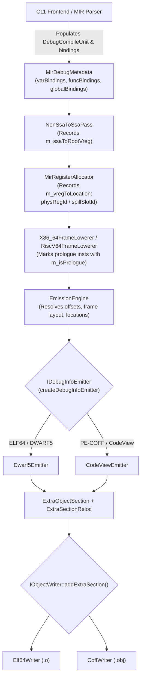

# EzPacker Debugging Information Architecture & User Guide

[EzPacker Documentation Index](index.md) > **Debugging Information**

---

## 1. Overview

EzPacker includes an end-to-end, target-independent debugging information subsystem that emits native **DWARF v5** sections for Linux/Unix ELF64 targets (x86-64 and RISC-V 64) and **Microsoft CodeView CV8 C13** sections for Windows PE/COFF targets (x86-64).

The design separates source-level metadata collection from binary container serialization:
- **Frontends** (the embedded C11 `chibicc` frontend and the textual `.mir` parser) populate a target-independent `EzCore::Debug::DebugCompileUnit` inside `MirDebugMetadata`.
- **Middle-End & Backend Passes** preserve source locations (`SourceReference`) and record register/spill/prologue mappings (`m_ssaToRootVreg`, `m_vregToLocation`, `m_isPrologue`) without needing format-specific logic.
- **Code Emission (`EmissionEngine`)** resolves final machine offsets, stack frame layouts, and hardware register numbers into the `DebugCompileUnit`, then dispatches to `IDebugInfoEmitter` (`Dwarf5Emitter` or `CodeViewEmitter`) to produce `ExtraObjectSection` payloads consumed by `IObjectWriter` (`Elf64Writer` or `CoffWriter`).

---

## 2. RTTI & Target-Independent Debug Model (`EzCore`)

EzPacker shares structural type descriptions between its Runtime Type Information (`EzCore/include/Rtti/RttiDescriptor.h`) and its debug information model (`EzCore/include/Debug/DebugInfo.h`).

### 2.1 Shared RTTI Foundations (`RttiDescriptor.h`)
- **`EzCore::RttiTypeKind`**: Classifies structural type kinds (`Void`, `Boolean`, `SignedInt`, `UnsignedInt`, `Float`, `Pointer`, `Array`, `Struct`, `Union`, `Enum`, `Function`, `Vector`, `Typedef`).
- **`EzCore::RttiMemberDescriptor`**: Describes aggregate fields (`name`, `typeId`, `byteOffset`, `bitOffset`, `bitWidth`).
- **`EzCore::RttiTypeDescriptor`**: Captures `typeId` (64-bit FNV-1a hash via `computeTypeId`), `typeName`, `sizeInBytes`, `alignment`, `kind`, `declarationSite` (`SourceRefData`), and `members`.

### 2.2 `EzCore::Debug::DebugCompileUnit` (`DebugInfo.h`)
`DebugCompileUnit` is the root container for all target-independent debug data in a translation unit:
- **Unit Metadata**: `producer`, `language` (`DebugLanguage::C11` or `DebugLanguage::Mir`), `level` (`DebugLevel::None`, `LineTablesOnly`, `Full`), `compDir`, `mainFile`, `pointerSize`, `isLittleEndian`, and `arch` (`TargetArch::X86_64`, `RiscV64`, `AArch64`).
- **Source File Table (`files`)**: `DebugSourceFile` entries managed via `addOrGetFile()`, which normalizes `/` and `\` path separators and assigns 1-based `fileId` values.
- **Type Table (`types`)**: `DebugType` records indexed by 64-bit `typeId` via `addType()` / `findType()`, supporting primitives (`DebugBaseEncoding`), pointers, arrays, structs/unions (`DebugMember`), enums (`DebugEnumerator`), typedefs, and function signatures.
- **Functions (`functions`)**: `DebugFunction` records holding `sectionOffset`, `codeSize`, `prologueSize`, `totalFrameSize`, `hasFramePointer`, `savedRegs` (`DebugSavedReg` with CFA offsets), `parameters` / `locals` (`DebugVariable` with `DebugVarLocation`), and `lineEntries` (`DebugLineEntry`).
- **Globals (`globals`)**: `DebugGlobalVar` records holding `sectionName`, `sectionOffset`, `sizeInBytes`, `isExternal`, and `isConstant`.
- **Structural Validation**: `DebugCompileUnit::validate(std::string &outError)` checks pointer size, unique non-zero IDs, valid file/type references, and monotonic line entries within function `codeSize`.

---

## 3. End-to-End Pipeline Flow



1. **Frontend Binding (`EzMir/include/Debug/MirDebugMetadata.h`)**:
   - The frontend registers types and files on `MirDebugMetadata::compileUnit` and records `MirDebugVarBinding` (linking `varName` + `typeId` to a `stackObjId` or pre-SSA `vregId`), `MirDebugFuncBinding`, and `MirDebugGlobalBinding`.
2. **SSA Root Virtual Register Tracking (`NonSsaToSsaPass`)**:
   - When `NonSsaToSsaPass` renames virtual registers into SSA form, it populates `MirFunctionAnalysisData::m_ssaToRootVreg[newRegId] = origRegId` so variables promoted to registers can still be traced back to their frontend `MirDebugVarBinding::vregId`.
3. **Register & Spill Tracking (`MirRegisterAllocator`)**:
   - During graph-coloring register allocation, `MirRegisterAllocator` populates `MirFunctionAnalysisData::m_vregToLocation` with `MirFunctionDebugLocation` (`isSpill`, `physRegId`, `isFpr`, `spillSlotId`).
4. **Prologue Marking (`X86_64FrameLowerer` / `RiscV64FrameLowerer`)**:
   - Frame lowering marks every machine instruction emitted in the function prologue using `MirInstruction::setIsPrologue(true)` (`m_isPrologue`).
5. **Final Resolution (`EmissionEngine`)**:
   - During machine code emission, `EmissionEngine` tracks instruction byte offsets (`DebugLineEntry`), identifies `prologueSize` / `prologueEnd` from `m_isPrologue`, resolves `DebugVarLocation` (`FrameBaseOffset`, `StackPointerOffset`, `Register`, `GlobalSymbol`), and records callee-saved register CFA offsets (`DebugSavedReg`).
   - When `-g1` (`DebugLevel::LineTablesOnly`) is selected, type, variable, and global metadata are omitted to keep debug output minimal while preserving line tables and stack-trace metadata.

---

## 4. Target Formats

### 4.1 Linux ELF64 — DWARF v5 (`Dwarf5Emitter`)
For ELF64 targets (`x86_64-linux-gnu`, `riscv64-linux-gnu`), `Dwarf5Emitter` serializes the `DebugCompileUnit` into standard DWARF v5 sections (plus DWARF `.debug_frame` CFI):

| Section | Purpose |
| :--- | :--- |
| `.debug_str` | Deduplicated null-terminated strings (`SHF_MERGE \| SHF_STRINGS`) referenced via `DW_FORM_strp`. |
| `.debug_line_str` | Line-table directory and file strings (`SHF_MERGE \| SHF_STRINGS`) referenced via `DW_FORM_line_strp`. |
| `.debug_abbrev` | DWARF v5 abbreviation tables defining DIE tags (`DW_TAG_compile_unit`, `DW_TAG_subprogram`, `DW_TAG_formal_parameter`, `DW_TAG_variable`, `DW_TAG_base_type`, `DW_TAG_structure_type`, etc.). |
| `.debug_info` | DWARF v5 compilation unit header (`version = 5`, `DW_UT_compile`) and DIE tree with relocations to `.text`, `.data`/`.rodata`/`.bss`, `.debug_abbrev`, `.debug_str`, and `.debug_line`. |
| `.debug_line` | DWARF v5 line number program header (`version = 5`) and state-machine bytecode mapping `codeOffset` to `(fileId, line, column, is_stmt, prologue_end, epilogue_begin)`. |
| `.debug_frame` | Call Frame Information (CIE + per-function FDEs) describing CFA rules and callee-saved register spill offsets (`DebugSavedReg`) for stack unwinding on x86-64 and RISC-V 64. |

`Elf64Writer` automatically emits `STT_SECTION` local symbols when `ExtraSectionReloc::m_targetIsSection` is true so section-relative DWARF relocations resolve cleanly during linking.

### 4.2 Windows PE/COFF — CodeView CV8 C13 (`CodeViewEmitter`)
For Windows PE/COFF targets (`x86_64-pc-windows-msvc`), `CodeViewEmitter` emits Microsoft CodeView v8 (CV8) C13 debug sections:

| Section | Purpose |
| :--- | :--- |
| `.debug$T` | CodeView type records (`CV_SIGNATURE_C13` / `CV_SIGNATURE_C7`), encoding primitive types, `LF_POINTER`, `LF_ARRAY`, `LF_STRUCTURE`, `LF_UNION`, `LF_ENUM`, `LF_FIELDLIST`, `LF_PROCEDURE`, and `LF_ARGLIST`. |
| `.debug$S` | CodeView symbol & line subsections (`DEBUG_S_SYMBOLS`, `DEBUG_S_LINES`, `DEBUG_S_FILECHKSMS`, `DEBUG_S_STRINGTABLE`), including `S_OBJNAME`, `S_COMPILE3`, `S_GPROC32`/`S_LPROC32`, `S_FRAMEPROC`, `S_REGREL32`, `S_REGISTER`, `S_GDATA32`/`S_LDATA32`, and `S_END`. |

`CodeViewEmitter` emits `TargetCodeRelocationType::SecRel32` and `TargetCodeRelocationType::SecIndex16` fixups for code/data symbol references inside `.debug$S`. `CoffWriter` translates these into `IMAGE_REL_AMD64_SECREL` (`0x000B`) and `IMAGE_REL_AMD64_SECTION` (`0x000A`), enabling MSVC `link.exe` and LLVM `lld-link` to merge CodeView records into a `.pdb` when invoked with `/DEBUG` (via `ez-ld -g` / `ez-ld --debug`).

---

## 5. CLI Reference

### 5.1 `ezc` (`EzCompiler`)
| Flag | Description |
| :--- | :--- |
| `-g`, `--debug-info` | Generate full debug information (alias for `-g2`). |
| `-g0` | Disable debug information generation (default). |
| `-g1` | Generate line-table-only debug information (`DebugLevel::LineTablesOnly`). |
| `-g2` | Generate full debug information (`DebugLevel::Full`: types, variables, locations, line tables, and CFI). |
| `--debug-format <format>` | Select debug container format: `auto` (default, DWARF5 for ELF, CodeView for COFF), `dwarf` (or `dwarf5`), or `codeview`. |

> [!NOTE]
> `-g`/`--debug-info`, `-g0`, `-g1`, and `-g2` are mutually exclusive; passing more than one reports a CLI argument error.

### 5.2 `ez-ld` (`EzLinker`)
| Flag | Description |
| :--- | :--- |
| `-g`, `--debug` | Enable debug information output at link time (passes `/DEBUG` to `lld-link` / `link.exe` on Windows to generate a `.pdb` file). |

---

## 6. Debugging Workflows

### 6.1 Linux (GDB)
Compile a C11 source file with `-g` (`-g2`) and link into an ELF64 executable:
```bash
ezc -g -fhosted hello.c -o hello.o
ez-ld --hosted hello.o -o hello
gdb ./hello
```
Inside `gdb`:
```gdb
(gdb) break main
(gdb) run
(gdb) next
(gdb) info locals
(gdb) print my_var
(gdb) backtrace
```
You can also inspect the emitted DWARF v5 sections directly:
```bash
readelf --debug-dump=info,line,frames hello.o
```

### 6.2 Windows (Visual Studio / WinDbg / `lld-link`)
Compile with `-g` targeting `x86_64-pc-windows-msvc` and link with `ez-ld -g` to produce both `hello.exe` and `hello.pdb`:
```powershell
ezc -g -fhosted --target x86_64-pc-windows-msvc hello.c -o hello.obj
ez-ld -g --hosted hello.obj -o hello.exe
```
Open `hello.exe` in Visual Studio or WinDbg (`windbg hello.exe`) to step through C11 source lines, inspect local variables/structs, and view call stacks. To inspect raw CodeView subsections in the `.obj`:
```powershell
llvm-readobj --codeview hello.obj
```

---

## 7. Extensibility Guide

### 7.1 Adding a New Architecture (e.g., AArch64)
`EzCore::Debug::DebugCompileUnit::TargetArch::AArch64` and `EzCore::Debug::mapAArch64ToDwarfReg()` are already defined in `EzCore/include/Debug/DebugInfo.h`. To complete debug support for a new architecture backend:

- Frame Lowering: Mark all prologue instructions with `inst->setIsPrologue(true)` in the target's `FrameLowerer` and populate `MirFunctionAnalysisData::m_totalFrameSize`, `m_calleeSavedAreaSize`, and `m_prologueInstCount`.
- Register Mapping: Implement/verify DWARF (and CodeView, if targeting Windows) register number mappings in `EzCore/src/Debug/DebugInfo.cpp` and wire them in `Dwarf5Emitter` / `CodeViewEmitter`.
- CIE Return Address & Alignment: Add target-specific CIE defaults (e.g., DWARF return address register `x30` = DWARF reg 30 for AArch64) in `Dwarf5Emitter::emitDebugFrame()`.

### 7.2 Adding a New Object Format (e.g., Mach-O)

- Object Writer: Implement `EzCodeEmitter::ObjectFormat::IObjectWriter` (including `addExtraSection(const ExtraObjectSection &)`), mapping `ExtraObjectSection::m_name` (e.g. DWARF `__DWARF,__debug_info` section naming on Mach-O) and `ExtraSectionReloc` fixups.
- Emitter Factory: Update `EzCodeEmitter::Debug::createDebugInfoEmitter()` in `EzCodeEmitter/include/Debug/IDebugInfoEmitter.h` if the new format requires a specialized emitter or section naming adapter.
