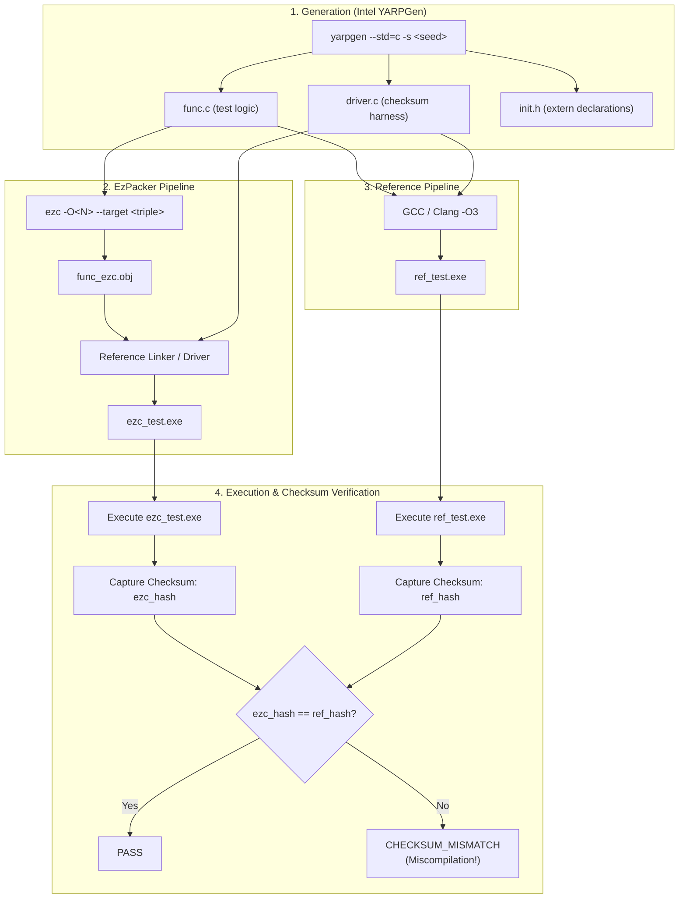

# YARPGen Differential Testing & Fuzzing Suite

This document describes the design, execution, and triage workflow of the **YARPGen Differential Testing Suite** in **EzPacker**.

---

## 🎯 Purpose and Philosophy

The primary objective of this suite is to automatically uncover:
1. **Miscompilations / Semantic Bugs**: The compiled code generates invalid machine instructions that silently produce incorrect mathematical or logical results.
2. **Compiler Panics & Crashes**: Unhandled opcodes, invalid instruction selections, internal assertion failures, or memory corruption during MIR lowering and code emission.
3. **ABI & Linker Failures**: Incompatibilities in calling conventions, stack alignment, parameter passing, or object symbol generation.

To accomplish this with mathematical rigor and zero false positives, the suite uses **[Intel YARPGen](https://github.com/intel/yarpgen)** to generate randomly synthesized, structurally complex, yet guaranteed statically and dynamically valid C programs. These programs are free of undefined behavior (UB), but heavily exercise scalar optimizations, nested loops, bitwise logic, arithmetic folding, and type conversions.

---

## 🏗️ Architecture & Workflow



---

## 🚀 Running the Tests

### 1. Deterministic CTest Regression Suite

The regression suite runs curated, deterministic seeds directly inside CTest:

```bash
# Run all YARPGen regression tests
ctest --test-dir cmake-build-debug -R "EzCompilerYarpgen" --output-on-failure
```

### 2. Launching On-Demand Fuzzing Campaigns via CMake

You can trigger a parallelized fuzzing campaign directly with the custom CMake target:

```bash
cmake --build cmake-build-debug --target fuzz-ezc
```

### 3. Running the Standalone Python Runner

The runner script [`tests/YarpgenDifferentialTests/yarpgen_runner.py`](../tests/YarpgenDifferentialTests/yarpgen_runner.py) can be run standalone with rich CLI parameters:

```bash
# Fuzz 50 random programs using 4 parallel jobs
python tests/YarpgenDifferentialTests/yarpgen_runner.py -n 50 -j 4

# Test a single seed for reproducibility
python tests/YarpgenDifferentialTests/yarpgen_runner.py --seed 401871035 --opt-levels O0,O2

# Run against specific optimization levels with custom timeout
python tests/YarpgenDifferentialTests/yarpgen_runner.py -n 20 --opt-levels O0,O1,O2,Os --timeout 15
```

---

## ⚙️ Command-Line Options Reference

| Argument | Description | Default |
| :--- | :--- | :--- |
| `--ezc-bin <path>` | Path to EzPacker `ezc` binary | Auto-detected |
| `--yarpgen-bin <path>` | Path to Intel `yarpgen` binary | Auto-detected |
| `--ref-compiler <path>` | Path to reference C compiler (`gcc` or `clang`) | Auto-detected |
| `--target <triple>` | Target architecture triple (`x86_64-pc-windows-coff`, etc.) | Host default |
| `--opt-levels <list>` | Comma-separated optimization levels to test (`O0,O1,O2,Os`) | `O0,O2` |
| `--mode <mode>` | `func-only` (compiles func with ezc, links with ref driver) or `full` | `func-only` |
| `--seed <N>`, `-s` | Run a single specific seed for instant replay | Random |
| `--seeds-file <file>` | Path to a text file containing regression seeds | `regression_seeds.txt` |
| `--iterations <N>`, `-n`| Number of random seeds to fuzz | `1` |
| `--jobs <J>`, `-j` | Number of concurrent worker threads | `1` |
| `--timeout <sec>` | Maximum time in seconds allowed per compilation/execution | `10.0` |
| `--work-dir <path>` | Scratch directory for test generation | `.yarpgen_work` |
| `--reproducers-dir <path>`| Directory where failure reproducers are isolated | `yarpgen_reproducers` |
| `--keep-passed` | Do not clean up temporary directories on passing runs | `false` |
| `--verbose`, `-v` | Output full compiler command lines and diagnostic details | `false` |

---

## 📦 Automated Bug Triage & Reproducers

Whenever an anomaly or failure is detected, the runner stops execution of that specific variant, halts cleanup, and creates a standalone reproducer bundle inside:

```
yarpgen_reproducers/<CATEGORY>_seed_<SEED>_<OPT>/
```

### Reproducer Bundle Contents:
- **`func.c`**: The generated computation logic exhibiting the bug.
- **`driver.c`**: The test harness, initializations, and checksum computation.
- **`init.h`**: External variable and array declarations.
- **`metadata.json`**: Machine-readable metadata capturing the compiler options, seed, host OS, timestamp, reference checksum, and exact command lines.
- **`error.log`**: Stderr / stdout diagnostics and backtraces.
- **`repro.bat` / `repro.sh`**: A one-click shell script to reproduce the failure instantly, emit MIR dumps (`--emit-mir`), and output assembly (`-S`).

### Failure Categories:

| Status Code | Description |
| :--- | :--- |
| `CHECKSUM_MISMATCH` | **Miscompilation Bug**: Both binaries ran to completion, but EzPacker produced a different mathematical hash than GCC/Clang. |
| `SELECTION_FAILURE` | Missing instruction selection pattern in `EzTriple` (e.g. unhandled `TRUNC` or `SEXT`). |
| `FRONTEND_FAILURE` | The `chibicc` C frontend encountered a syntax or type resolution error. |
| `EMISSION_FAILURE` | The binary code emitter or relocation resolver failed to encode the instruction. |
| `COMPILER_CRASH` | Internal compiler exception or segfault in `ezc`. |
| `LINK_FAILURE` | Symbol resolution or object file format incompatibility during linking. |
| `EXECUTION_CRASH` | The binary produced by EzPacker crashed with an unhandled exception or SIGSEGV at runtime. |
| `EXECUTION_TIMEOUT` | Infinite loop or excessive execution time in generated machine code. |

---

## 🛠️ Debugging a Failure

To debug a failure:
1. Open the reproducer directory:
   ```cmd
   cd yarpgen_reproducers\SELECTION_FAILURE_seed_401871035_O0
   ```
2. Run the reproducer script to reproduce the error and generate dumps:
   ```cmd
   repro.bat
   ```
3. Inspect `dump.mir` to examine the intermediate representation right before the failure.
4. Once the bug is fixed in EzPacker, run the seed again:
   ```cmd
   python tests/YarpgenDifferentialTests/yarpgen_runner.py --seed 401871035 --opt-levels O0
   ```
5. When verified, add the seed to `tests/YarpgenDifferentialTests/regression_seeds.txt` so it is permanently tracked by CI!

---

## ⚡ Big Stress Testing & Compiler Pass Profiling

To measure the real-world performance, execution time, and bottlenecks of every individual pass in EzPacker's compilation pipeline, the suite includes a dedicated multi-kernel stress profiler:

```bash
# Run the Big Stress Benchmark across all optimization levels (-O0, -O1, -O2, -Os)
python tests/YarpgenDifferentialTests/yarpgen_stress_bench.py --functions 10 --opt-level all

# Or trigger via CMake
cmake --build cmake-build-debug --target stress-ezc-passes
```

### What It Measures:
1. **Pass Execution Times**: Captures per-pass execution durations via `ezc --time-passes`.
2. **Bottleneck Analysis**: Identifies top bottleneck passes (e.g., `MirRegisterAllocatorPass`, `LivenessAnalysisPass`, `MirInstructionSelectorPass`).
3. **Multi-Scale Scalability**: Synthesizes a monolithic C stress file merging multiple distinct YARPGen function kernels, namespacing all variables and functions so they compile concurrently in a single compilation unit.
4. **Metrics Export**: Supports exporting benchmark results to JSON (`--json-out results.json`) or Markdown tables (`--markdown-out report.md`).

