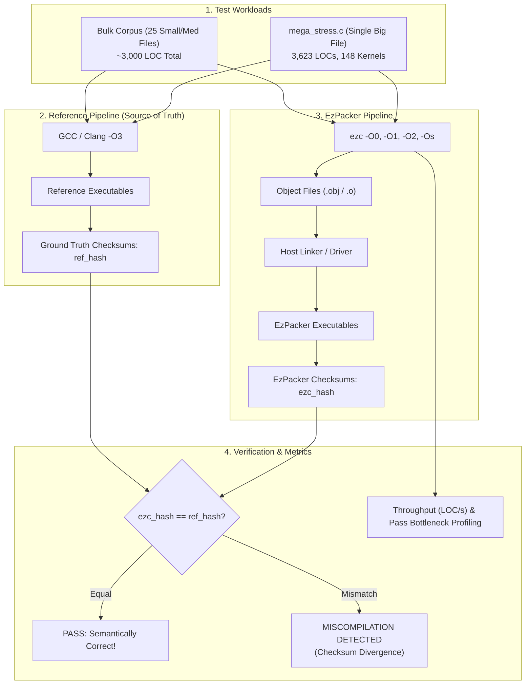

# YARPGen Differential Testing & Stress Compilation Suites

This document describes the design, execution, and triage workflow of the **Intel YARPGen Test Suites** in **EzPacker**.

---

## 🎯 Purpose and Philosophy

The primary objective of these suites is to mathematically test and verify **EzPacker's compiler pipeline (`ezc`)**:
1. **Miscompilations / Semantic Bugs**: The compiled code generates invalid machine instructions that silently produce incorrect mathematical or logical results. The **Reference Compiler (GCC or Clang)** acts as the source of truth to detect any execution discrepancy.
2. **Compiler Panics & Crashes**: Unhandled opcodes, invalid instruction selections, internal assertion failures, or memory exhaustion during MIR lowering and code emission.
3. **Multi-File Scalability & Throughput**: Benchmarking compilation latency, throughput (files/sec, LOC/sec), and pipeline pass stability across fleets of independent translation units.
4. **Monolithic AST / Stress Scalability**: Straining middle-end and backend algorithms (register allocation, liveness analysis, CFG traversals) on massive translation units (+3,000 LOCs).

To accomplish this with mathematical rigor and zero false positives, the suites utilize **[Intel YARPGen](https://github.com/intel/yarpgen)** to synthesize randomly structured, UB-free C programs that heavily exercise scalar optimizations, nested loops, bitwise logic, and type conversions.

---

## 🏗️ Architecture & Dual-Mode Workflow



---

## 🚀 The Two Primary Test Suites

EzPacker provides two distinct test suites designed for different testing and benchmarking goals:

### 1. Bulk File Compilation Suite (Multiple Small & Medium Files)

Exercises the compiler on a diverse fleet of independent, small-to-medium translation units (25 files in `tests/YarpgenDifferentialTests/bulk_corpus/`, each ~80–250 LOC, ~3,000 LOC total):
- **Compilation Mode**: Verifies that `ezc` compiles all 25 files without crashes, assertions, or frontend errors across optimization levels (`-O0`, `-O1`, `-O2`, `-Os`). Measures compilation throughput (LOC/sec and files/sec).
- **Differential Verification Mode**: Compiles each test with both GCC/Clang (`-O3`) and `ezc`, links with companion drivers (`driver_001.c` .. `driver_025.c`), executes, and asserts that `ezc_checksum == ref_checksum`.

#### How to Run:
```bash
# 1. Run via CMake Custom Target (Differential Verification if GCC/Clang found, else compilation):
cmake --build cmake-build-debug --target bulk-ezc

# 2. Run Pure Compilation Throughput Benchmark (All 25 files across -O0, -O1, -O2, -Os):
cmake --build cmake-build-debug --target bulk-ezc-compile

# 3. Run in CTest:
ctest --test-dir cmake-build-debug -R "EzCompilerYarpgen_BulkCompilation" --output-on-failure
ctest --test-dir cmake-build-debug -R "EzCompilerYarpgen_BulkDifferential" --output-on-failure

# 4. Standalone Python CLI:
python tests/YarpgenDifferentialTests/yarpgen_bulk_bench.py --compile-only --opt-levels O0,O2
python tests/YarpgenDifferentialTests/yarpgen_bulk_bench.py --ref-compiler gcc --opt-levels O0
```

#### Regenerating the Bulk Corpus:
You can synthesize a new batch of 25 small/medium tests via YARPGen on demand:
```bash
cmake --build cmake-build-debug --target bulk-ezc-regenerate
```

---

### 2. Single Big File Stress Suite (+3k LOCs)

Stresses the compiler pipeline using a single monolithic translation unit containing **3,623 lines of C code** and **148 distinct computationally intensive kernels**:
- **Monolithic Source File**: [`tests/YarpgenDifferentialTests/mega_stress.c`](mega_stress.c)
- **Companion Verification Driver**: [`tests/YarpgenDifferentialTests/mega_stress_driver.c`](mega_stress_driver.c)
- **Pass Profiling**: Measures middle-end and backend compiler pass execution times, percentage share, and bottleneck passes via `ezc --time-passes`.
- **Differential Verification**: Executes all 148 kernels in sequence, hashes all state variables, and compares the resulting 64-bit checksum against GCC/Clang to prove that the massive translation unit was compiled with zero semantic defects.

#### How to Run:
```bash
# 1. Run Single Big File Stress Benchmark & Pass Profiler across all optimization levels:
cmake --build cmake-build-debug --target stress-ezc-passes

# 2. Run Full Stress Compilation with Reference Compiler Verification:
cmake --build cmake-build-debug --target stress-ezc

# 3. Run in CTest:
ctest --test-dir cmake-build-debug -R "EzCompilerYarpgen_StressCompilation" --output-on-failure
ctest --test-dir cmake-build-debug -R "EzCompilerYarpgen_StressDifferential" --output-on-failure

# 4. Standalone Python CLI:
python tests/YarpgenDifferentialTests/yarpgen_stress_bench.py --opt-level O0 --compile-only
python tests/YarpgenDifferentialTests/yarpgen_stress_bench.py --opt-level O0 --ref-compiler gcc
```

---

## 🛠️ YARPGen Vendor Integration

YARPGen is imported into EzPacker using the standard vendor API in [`CMake/Vendor.cmake`](../CMake/Vendor.cmake):
```cmake
FetchContent_Declare(
        yarpgen
        GIT_REPOSITORY https://github.com/intel/yarpgen.git
        GIT_TAG 1adb290f453505838f3aa33dc571f292b0c1810f
        PATCH_COMMAND ${CMAKE_COMMAND} -E copy_directory
                      "${CMAKE_CURRENT_SOURCE_DIR}/CMake/yarpgen/overlay"
                      "<SOURCE_DIR>"
)

EzCMK_AddVendor(https://github.com/intel/yarpgen
        1adb290f453505838f3aa33dc571f292b0c1810f
        yarpgen
)
```

### Clean Overlay Pattern:
Upstream YARPGen's CMake scripts have side effects when included as a subproject (e.g. copying executables into `${CMAKE_SOURCE_DIR}/scripts` and building unused internal unit tests). To prevent repository pollution, EzPacker supplies an overlay in [`CMake/yarpgen/overlay/CMakeLists.txt`](../CMake/yarpgen/overlay/CMakeLists.txt):
- Builds target `yarpgen` directly into `${CMAKE_RUNTIME_OUTPUT_DIRECTORY}` (`bin/yarpgen.exe`).
- Excludes unused unit test binaries (`type_test`, `data_test`, etc.).
- Normalizes compiler flags across MSVC, MinGW, and Clang.

---

## ⚙️ CLI Runners Reference

### `yarpgen_bulk_bench.py`
| Argument | Description | Default |
| :--- | :--- | :--- |
| `--ezc-bin <path>` | Path to EzPacker `ezc` executable | Auto-detected |
| `--ref-compiler <path>` | Path to reference C compiler (`gcc` or `clang`) | Auto-detected |
| `--corpus-dir <path>` | Directory containing small/medium C test files | `bulk_corpus` |
| `--opt-levels <list>` | Comma-separated optimization levels | `O0,O2` |
| `--jobs <J>`, `-j` | Concurrent worker threads | `4` |
| `--compile-only` | Run pure compilation throughput test without execution | `false` |
| `--regenerate` | Synthesize N fresh files in `bulk_corpus` via YARPGen | `false` |
| `--count <N>` | Number of files when regenerating | `25` |
| `--json-out <path>` | Export benchmark metrics to JSON file | None |

### `yarpgen_stress_bench.py`
| Argument | Description | Default |
| :--- | :--- | :--- |
| `--file <path>` | Path to monolithic C stress file | `mega_stress.c` |
| `--ezc-bin <path>` | Path to EzPacker `ezc` executable | Auto-detected |
| `--ref-compiler <path>` | Path to reference C compiler for differential testing | None |
| `--opt-level <opt>` | Optimization level (`O0`, `O1`, `O2`, `Os`, or `all`) | `all` |
| `--compile-only` | Run compilation and pass profiling without execution | `false` |
| `--regenerate` | Synthesize monolithic stress file via YARPGen | `false` |
| `--json-out <path>` | Export pass timings and metrics to JSON file | None |
| `--markdown-out <path>` | Export pass distribution report to Markdown | None |

---

## 🏷️ CTest Labels Summary

All tests are integrated into CTest and can be filtered by labels:
- `ctest -L Bulk`: Runs all bulk file compilation tests.
- `ctest -L Stress`: Runs all single big file stress tests.
- `ctest -L Compilation`: Runs pure compiler stability and throughput tests.
- `ctest -L Differential`: Runs execution and checksum verification against GCC/Clang.
- `ctest -L Regression`: Runs curated deterministic seed regression tests.
- `ctest -L Yarpgen`: Runs the entire YARPGen test fleet.

---

## 🛡️ Curated Regression Seeds

The test suite tracks deterministic YARPGen seeds in `tests/YarpgenDifferentialTests/regression_seeds.txt`. Each seed targets a specific language construct or lowering edge case discovered during fuzzing:

| Seed | Target Construct / Fix Area |
| :--- | :--- |
| `401871035` | Narrowing integer truncation and implicit conversions (`TRUNC`) |
| `545245296` | Unary operators, sign extensions, and scalar assignment |
| `326683734` | Arithmetic expressions, min/max conditionals, and boolean tests |
| `1045802857` | Multi-operand comparisons, type width legalization |
| `1104` | Unsigned cast zero-extension, logical AND/OR comparison operand width matching |
| `121` | Bitwise operations, nested ternaries, and signed comparisons |

---

## 🐛 Compiler Defects Discovered & Resolved via Differential Testing

1. **`CMP_NE` Operand Bit-Width Mismatch in Logical AND/OR (`ND_LOGAND`, `ND_LOGOR`)**:
   - *Problem*: In `CFrontendAdapter.cpp`, `FlexInt(0)` was constructed without an explicit bit-width, defaulting to 32 bits. When lowering boolean expressions (`i1`) or sub-byte comparisons, `buildConstant` promoted constant operand types to `i32`, producing a `CMP_NE` with operand type mismatch (`i1` vs `i32`) which triggered `MirVerifierPass` aborts.
   - *Fix*: Created constants using explicit bit-widths derived from operand MIR types: `FlexInt(0, static_cast<uint16_t>(rhsType->getTotalSizeInBits()))`.
2. **Unsigned Integer Literal Clamping in `ND_NUM`**:
   - *Problem*: Integer literals with unsigned types (e.g. `(unsigned short)36391`) were treated as signed `int64_t` during AST node conversion, causing bit 15 to sign-extend and clamp to `-29145` via two's complement.
   - *Fix*: Preserved `ty->is_unsigned` and zero-extended literals when constructing `FlexInt`.
3. **Implicit Zero-Extension in `ND_CAST`**:
   - *Problem*: Casting an unsigned integer to a wider type signed-extended the raw value because `imm->getValue().getI64()` was used unconditionally.
   - *Fix*: Applied unsigned masking (`& ((1ULL << srcBits) - 1)`) when `node->lhs->ty->is_unsigned` is true.
4. **64-bit Integer Literal Truncation on Windows**:
   - *Problem*: Upstream `chibicc`'s `tokenize.c` used `strtoul` which returns a 32-bit `unsigned long` under the Windows LLP64 data model.
   - *Fix*: Upgraded to `strtoull` in the overlay, preserving full 64-bit precision for large literal seeds.
